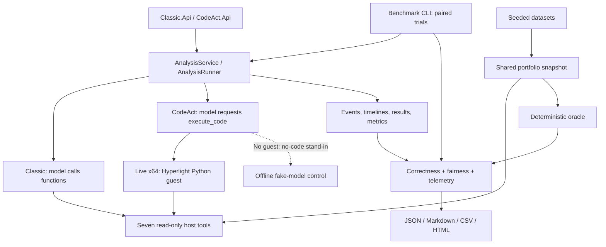

# Sterling Vale: Classic tool-calling vs. CodeAct

A .NET proof of concept comparing two ways an AI agent can analyze the same synthetic
wealth-management portfolio: call data tools directly, or write Python that calls those tools
inside a Hyperlight sandbox. The project includes reproducible datasets, a reference calculation,
paired comparisons, and inspectable execution artifacts. **The offline demo works on ARM64
without Azure or a sandbox. Ubuntu x64 now has real Hyperlight execution and an Exact
one-household live CodeAct result. Classic's InvalidSchema is a recorded model task outcome,
not an infrastructure-invalid comparison.**
This is a POC, not a production service or investment advice.

## 1. Goal

Does CodeAct-style code execution improve **accuracy, tokens, latency, estimated cost, or
number of calls** compared with classic tool-calling as the dataset grows?

The intended comparison holds data, seven underlying tools, task instructions, output schema,
model configuration, and pricing constant. The orchestration changes.
The shared prompt body is fingerprinted; each mode also has a different mechanism addendum.
Matching fingerprints checks configuration consistency, not scientific equivalence by itself.

**No winner is assumed.** Offline controls answer a narrower question: does the comparison
harness produce correct reports and internally consistent telemetry?

## 2. Premise & background

| Term | Plain-English meaning |
| --- | --- |
| Classic tool-calling | The model requests named functions with structured arguments, receives results, and decides what to do next. A response can contain multiple tool calls; one call does not necessarily mean one network round-trip. |
| CodeAct | The model writes and runs code that calls tools, loops, and computes intermediate results. This can move work out of repeated model interactions. |
| Hyperlight | An embedded, hypervisor-isolated micro-VM for untrusted code. Here it hosts the Python guest; it needs supported x64 hardware and virtualization. |
| Microsoft Agent Framework | The .NET agent layer managing model interactions and function invocation. Both modes use it; CodeAct additionally uses its Hyperlight provider. |

Why compare them? Larger portfolios require repeated retrieval, arithmetic, and structured
output. Code may make that work easier to express, but generated code, sandbox overhead,
output limits, and model errors can offset the benefit. Measure correctness before efficiency.
The current CodeAct prompt requests multiple small code executions to accommodate guest output
limits; this implementation does **not** promise one program or constant model calls.

Background sources:
[function calling](https://platform.openai.com/docs/guides/function-calling),
[CodeAct paper](https://arxiv.org/abs/2402.01030),
[Hyperlight](https://github.com/hyperlight-dev/hyperlight), and
[Microsoft Agent Framework](https://learn.microsoft.com/en-us/agent-framework/overview/).
The pinned preview APIs are recorded in [SDK findings](docs/sdk-findings.md).

## 3. The scenario

**Sterling Vale** is a fictional wealth manager. Its synthetic households own accounts and
positions across asset classes and currencies. Seeded generation produces these sizes:

| Profile | Households | Accounts | Positions |
| --- | ---: | ---: | ---: |
| Small | 10 | 33 | 370 |
| Medium | 40 | 156 | 2,201 |
| Large | 120 | 485 | 7,198 |

For each household, the agent should:

1. Retrieve its policy, accounts, positions, prices, FX rates, and classifications.
2. Value positions in the household's base currency and compute allocations.
3. Flag drift, concentration, foreign-currency, and crypto policy breaches.
4. Propose asset-class buy/sell notionals, not named securities.
5. Return a schema-valid `ExposureReport`.

The deterministic **oracle** independently calculates the reference report for live scoring.
It checks flagged households, breaches, allocations, and trade notionals using documented
rounding and tolerances. It is not exposed as an agent tool.
**Offline only:** the fake model's answer is deliberately generated from this same oracle,
so an exact match validates plumbing, not independent model reasoning.
See [calculation rules](docs/metrics.md) and [comparison methodology](docs/benchmark-methodology.md).

## 4. How it works



The CLI generates one oracle reference per profile, warms up each mode once, randomizes paired
execution order, runs both modes, scores their reports, and writes artifacts. Warm-ups are
excluded from measured comparisons. Both APIs expose the same analysis and run-retrieval contract.
Tools use direct `AIFunction` callbacks, **not MCP**.

### Source projects

All names below live under [src/](src/), with the `SterlingVale.` prefix.

| Project suffix | Responsibility |
| --- | --- |
| Domain | Portfolio model, money, financial math, reports, and metrics. |
| Application | Portfolio snapshots, FX conversion, and the reference oracle. |
| Tools | Seven read-only retrieval/classification functions and invocation recording. |
| AgentShared | Prompts, schemas, shared runner/service, Classic factory, and fake model. |
| CodeAct | Hyperlight agent factory and explicit no-guest stand-in. |
| Infrastructure | Dataset loading, Azure/fake client selection, DI, and file run storage. |
| Telemetry | Correlation, ordered event journals, payload policy, timelines, and console output. |
| Api.Shared | Shared HTTP endpoints, validation, and response mapping. |
| Classic.Api | Thin ASP.NET host for the Classic factory. |
| CodeAct.Api | Thin ASP.NET host for the CodeAct factory. |
| DataGenerator | Seeded Small/Medium/Large data and hash manifests. |
| Benchmark | Paired execution, scoring, aggregation, CLI, and report rendering. |

### Test projects

All names below live under [tests/](tests/), also prefixed `SterlingVale.`.

| Project suffix | Coverage |
| --- | --- |
| Domain.Tests | Value objects, math, and invariants. |
| Application.Tests | Oracle, FX, and portfolio calculations. |
| Data.Tests | Deterministic generation, loading, and manifests. |
| Tools.Tests | Tool contracts, recording, event isolation, payloads, and timelines. |
| AgentShared.Tests | Runner limits, fake clients, schemas, artifacts, and reconciliation. |
| Architecture.Tests | Dependency boundaries. |
| Contract.Tests | Cross-mode HTTP/schema/tool consistency. |
| Classic.IntegrationTests | Classic API using offline clients, plus opt-in live tests. |
| CodeAct.IntegrationTests | Offline API and separately gated real-Hyperlight tests. |
| Comparison.Tests | Scoring, aggregation, reports, and all-profile offline comparisons. |

More detail: [architecture](docs/architecture.md) and [security model](docs/security-model.md).

## 5. Quickstart: offline demo

### Prerequisites

- Git and .NET 9 SDK per [global.json](global.json); validated with SDK **9.0.320** on the laptop
  and pinned **9.0.317** on Ubuntu x64, with configured roll-forward.
- A terminal running PowerShell: Windows PowerShell works here; PowerShell 7 is available
  for Windows, Linux, and macOS. No Python, Azure account, guest image, or virtualization required.
- Package-feed access for the first restore. Allow a few minutes for initial downloads.

**Verification scope:** the sequence below succeeded in a clean local-source clone on Windows
ARM64. Ubuntu x64 additionally passed local-source clean-clone locked restore, Release build and
231 non-live tests at `3088451`, using an empty NuGet cache. The current validity/reporting changes pass 249.
The complete quickstart on Linux/macOS and a remote-origin clone are **not yet verified**.

Clone setup template (**remote clone not yet verified**; replace the placeholder):

```powershell
git clone --branch feature/observability-validation <repository-url> codeact-poc
Set-Location codeact-poc
```

From the repository root, paste these into one terminal. The explicit environment settings
prevent inherited Azure, guest, batching, pricing, or output-directory settings changing the demo:

```powershell
$env:AZURE_OPENAI_ENDPOINT = ""
$env:HYPERLIGHT_PYTHON_GUEST_PATH = ""
$env:BENCHMARK_REQUIRE_LIVE = "false"
$env:CLASSIC_BATCH_SIZE = "0"
$env:DATASET_ROOT = "data"
$env:ARTIFACTS_ROOT = "artifacts"
$env:BENCHMARK_MAX_TURNS = "12"
$env:BENCHMARK_TIMEOUT_SECONDS = "120"
$env:PRICING_INPUT_PER_MILLION = "2.50"
$env:PRICING_OUTPUT_PER_MILLION = "10.00"
$env:ENABLE_LIVE_TESTS = "false"
$env:OTEL_EXPORTER_OTLP_ENDPOINT = ""
$generator = Join-Path src SterlingVale.DataGenerator
$benchmark = Join-Path src SterlingVale.Benchmark
dotnet restore --locked-mode
dotnet build -c Release --no-restore
dotnet run -c Release --no-build --project $generator -- data
dotnet run -c Release --no-build --project $benchmark -- validate-data
dotnet run -c Release --no-build --project $benchmark -- compare --trials 1 --model fake --log-level normal --payload-capture full
dotnet run -c Release --no-build --project $benchmark -- visualize
```

Stop on failure; an old dashboard is not evidence of success. `compare` runs all available profiles;
`visualize` combines the latest per profile. Its printed HTML path opens without external assets.

Actual output excerpt, with changing comparison ID omitted:

```text
[small] VALID — 10 households, 33 accounts, 370 positions; on-disk manifest present
[medium] VALID — 40 households, 156 accounts, 2201 positions; on-disk manifest present
[large] VALID — 120 households, 485 accounts, 7198 positions; on-disk manifest present
Model selected: fake. Reason: explicit fake control; Azure environment variables are ignored.
Completion: 2/2; correctness (Exact/WithinTolerance): 2/2
COMPARISON VALID
Execution kind: offline-fake-control
Fairness: MATCHED; telemetry: VALID (accounting only, not success)
```

Optional verification, also run successfully:

```powershell
dotnet test -c Release --no-build --filter "Category!=LiveModel&Category!=Hyperlight"
```

Current result: **249 passed, 0 failed, 0 skipped across ten projects**, including
worker containment/recovery and model-outcome/infrastructure-validity regressions. On the ARM64 laptop the six Hyperlight tests
previously skipped; on Ubuntu x64 five pass, while native cancellation remains a labelled
known issue. Neither a skip nor an excluded known issue is a pass.

## 6. What the results show

### Fake-model controls, NOT real performance

This laptop's fake client makes one representative tool request, then emits a precomputed oracle
report. Classic calls `list_households`; CodeAct calls a stand-in `execute_code` that runs
**no Python** and invokes **no data callbacks**. Neither mode performs live model analysis.

Fresh local-clone run at `2026-11-06T00:30Z` (November 5 local time), one measured pair per
profile after warm-up; values below were read from the generated comparison JSON:

| Profile | Oracle match, both | Fairness / telemetry | Fake tokens, each mode | Formula USD, each mode | Harness ms, Classic / CodeAct |
| --- | --- | --- | ---: | ---: | ---: |
| Small | Exact | MATCHED / VALID | 4,174 | 0.041425 | 20.1399 / 17.7399 |
| Medium | Exact | MATCHED / VALID | 16,230 | 0.161970 | 40.9000 / 40.1731 |
| Large | Exact | MATCHED / VALID | 49,208 | 0.491765 | 113.1979 / 106.6385 |

For every profile: two model turns per mode, one model-facing invocation per mode,
Classic/CodeAct granular calls **1/0**, `execute_code` invocations **0/1**, sandbox callbacks **0/0**.
Both modes had flagged/breach precision and recall 1, allocation/trade error 0.
Fake tokens and formula costs are identical; wall-clock timings vary.
**These numbers validate the harness and telemetry, not a speedup, model accuracy, or Azure bill.**

| Metric | Interpretation |
| --- | --- |
| Correctness | Schema validity plus oracle match class, flagged/breach precision and recall, allocation MAE, and trade-notional error as a household-value fraction. |
| Duration | Reported trial wall time around analysis; includes observation/persistence inside the service, excludes warm-up and later report rendering. Not model-only or micro-VM CPU time. |
| Tokens | Per-response input/output/total usage aggregated across the run; unknown remains null. Offline usage is synthetic. |
| Estimated USD | Input/output tokens times configured per-million prices; not an invoice. |
| Model turns | Assistant responses observed at the model boundary; distinguish them from function invocations. |
| Model-facing calls | Functions requested by the model: granular tools for Classic, `execute_code` for CodeAct. |
| Granular calls | Actual host data-tool invocations, including real CodeAct callbacks; legacy `toolCallCount` now means this. |
| Sandbox callbacks | Granular calls originating from CodeAct; zero in this no-guest control. |
| Telemetry valid | Events, invocation counts, and token totals reconcile. It does not imply correctness or real sandbox execution. |

### Reports and evidence

| Relative location | Contents |
| --- | --- |
| `<ARTIFACTS_ROOT>/index.md` | Comparisons and runs, status, warm-up labels, and available timeline/code/tool-invocation links. |
| `artifacts/comparisons/{id}.{json,md,csv,html}` | Raw trials, summaries, scores, fingerprints, execution kind, and dashboards. |
| `artifacts/comparisons/{id}/summary.{json,md}` | Additional comparison summary. |
| `artifacts/comparisons/scaling-{timestamp}.html` | Latest-per-profile overview; check execution kinds before mixing runs. |
| `artifacts/runs/{runId}/result.json`, `metrics.json`, `metadata.json` | Structured result, metrics, identity, and configuration. |
| `events.jsonl`, `timeline.json`, `timeline.md` within each run | Ordered boundary events and their references. |
| `model/`, `tools/`, `classic/`, `codeact/` within each run | Requests/responses, invocations, final-response captures, generated programs, and available streams. |

Default payload capture is metadata only; live generated Python is saved independently of this mode.
The demo uses `full`; payloads/source are redacted and capped at 65,536 characters. Exact source must be safe and complete.
Use capture flags, not assumptions about a missing stream or source file.
`transcript.jsonl` retains every message and call/result identity. For observed runs, text, arguments
and results are separate capture envelopes with content/length/truncation/redaction fields; large
payloads can be partial, but no whole-file cutoff removes later calls or breaks JSONL framing.
Separate generated Python captures still require an unredacted, untruncated program for a `.py` file;
otherwise a `.capture.json` explicitly marks the unavailable exact source.
Current evidence and IDs: [POC demo review](docs/review-current/poc-demo-review.md).

Correctness comes first in console/JSON/HTML summaries, alongside both modes' full metrics.
Comparison validity is independent of model success:

- **INVALID; stop the sweep:** infrastructure/harness failures, including auth/model-call
  errors, worker crashes, missing guest/execution, fairness/config/prompt-hash mismatches,
  missing/unpaired trials, or telemetry reconciliation failures. Warm-up infrastructure failures
  also stop execution. Exit nonzero; suppress aggregate performance statistics, retain raw evidence.
- **VALID; record and continue:** model task outcomes such as InvalidSchema, Partial, declared
  incomplete, turn cap, or TimedOut at the configured deadline, with intact harness evidence.
  Exit zero; retain every trial in medians, including failed/slow task outcomes. VALID is not a pass.

Both modes' status/oracle, turns, named calls, input/output tokens, analysis duration, estimated
cost, execute_code and callbacks are shown per trial and as medians. Unknown remains unavailable.
Efficiency deltas are withheld unless every measured trial is oracle-correct; when shown,
both modes' correctness appears alongside them. Lower tokens/latency on an incorrect report
is never labelled a win. Process-inclusive timing remains separately available.
Telemetry can reconcile a failed request: **VALID accounting is not successful analysis**.
Warm-ups are persisted and labelled **WARM-UP, not measured**. Normal logs show full IDs at
RUN STARTED, then an eight-character run prefix; verbose/debug and disk journals retain full IDs.

## 7. Running live

**Live ARM64, November 11:** connectivity works. New scoped trials below are oracle-scored,
not performance claims. Classic's schema-valid reports were **Partial**, not correct; CodeAct
generated Python but was **NotExecuted: no Hyperlight guest**. Both comparisons returned exit 1.
Configure these variables in the same terminal; do not put real values in source or artifacts:

| Variable | Purpose |
| --- | --- |
| `AZURE_OPENAI_ENDPOINT` | HTTPS resource address; pasted `/openai/v1` paths are normalized to the base with a one-line notice. |
| `AZURE_OPENAI_DEPLOYMENT_NAME` | Exact chat deployment name, not merely a model identifier. |
| `AZURE_OPENAI_API_KEY` | Optional alternative to `DefaultAzureCredential`; keep outside artifacts. |

Default is `--model fake`, **even with Azure variables set**. Only `--model live` opts in; no fallback.
APIs also default to fake; opt in with `--model live` or `MODEL_MODE=live`.
Copying [.env.example](.env.example) does not load shell variables.

Identity/deployment setup templates below are **not yet verified/executed**; replace placeholders:

```powershell
az login --tenant <tenant-id>
az account set --subscription <subscription-id>
az cognitiveservices account deployment list --resource-group <resource-group> --name <resource-name> --query "[].name" --output tsv
```

Use the **deployment name**, not the model name. Example base: `https://<resource-name>.openai.azure.com/`.
The SDK uses this authority with `/`; path/query/fragment are removed, not silently sent as a second route.
An authorized administrator can grant **Cognitive Services OpenAI User** at the resource scope;
See [RBAC steps and diagnosis](docs/review-current/poc-demo-review.md#azure-setup-templates); no resource changes were performed.

Laptop connectivity/generation check, **executed but not yet verified as a successful comparison**:

```powershell
$env:BENCHMARK_REQUIRE_LIVE = "false"
$env:HYPERLIGHT_PYTHON_GUEST_PATH = ""
$env:BENCHMARK_MAX_TURNS = "20"
$env:BENCHMARK_TIMEOUT_SECONDS = "120"
$benchmark = Join-Path src SterlingVale.Benchmark
dotnet run -c Release --no-build --project $benchmark -- run --profile small --trials 1 --households 1 --model live --log-level normal --payload-capture full
dotnet run -c Release --no-build --project $benchmark -- run --profile small --trials 1 --households 3 --model live --log-level normal --payload-capture full
```

`--households N` selects the first N dataset households for both agents, warm-ups and oracle; default is all.
Measured runs after warm-up, **live ARM64, November 12, 2026**, shared prompt v2 with plain JSON mode (before schema-format changes).
CodeAct tokens: **first turn only, code not executed: not comparable to Classic totals**.

| N | Classic status / finish / turns | Input / output tokens | Duration ms | Oracle | CodeAct turns / input / output / Python bytes |
| ---: | --- | ---: | ---: | --- | --- |
| 1 | Failed / stop / 6 | 21,079 / 1,082 | 16,003.170 | InvalidSchema (`Hold`) | 1 / 2,176 / 1,258 / 5,017 |
| 3 | Completed / stop / 5 | 37,101 / 974 | 14,763.335 | Partial (zero reports) | 1 / 2,184 / 536 / 1,616 |

Classic retrieved complete price evidence for all scoped positions but produced zero/placeholder values while declaring complete.
**Hypothesis (unverified until CodeAct executes):** in-context arithmetic across many positions is unreliable.
`get_price` / positions: **13 / 26** (N=1), **17 / 117** (N=3); all 13/17 distinct symbols covered.
Asset class already comes with position data; `asset_class=0` is **not** a classification shortcut.
The earlier full-Small run's gap was missing prices (`get_price=0`); these scoped runs also show
incorrect computation despite price coverage. Both CodeAct runs were NotExecuted.
V2 requires `status` and `missingItems`; explicit `incomplete` is **Partial, never Exact**, even with exact values.
Classic runs with parallel tool calls enabled (model default); disabling it would multiply Classic's turns and isn't how the pattern is used in practice.
Both modes explicitly set `parallel_tool_calls=true`, non-strict `json_schema` (`strict=false`), and a 16,384-token output cap.
The schema guides output; full local v2 validation, not server-side strict guarantees, decides acceptance.
The scoped VM result below exercises these settings; full-profile correctness remains unverified.
Startup prints the format, parallel and strict choices for both modes.
Settings and both schema hashes are recorded; scaling rejects mixed prompt/model configurations.
See [prompt boundary, per-tool tables and prior results](docs/review-current/poc-demo-review.md#approved-shared-prompt-v2-live-follow-up).
Finish reason, last-response output tokens, a redacted 240-character preview and zero-inclusive counts
are persisted in each run's `summary.json`, final event and comparison; generated-source events include byte counts.
N=3's two CodeAct calls were distinct requests in one model response (159 + 1,457 bytes), both NotExecuted, not two turns.
Safe live Python lands in `codeact/generated-code-*.py` even with metadata/none capture; unsafe/oversized source gets markers.
Failure events contain safe category/status/code/guidance, not raw server text. Live calls incur charges.

An x64 guest adds **actual Python execution, callbacks and a scoreable report**; pass the five
supported runtime tests first, explicitly excluding the retained `HyperlightKnownIssue`.
The optional `BENCHMARK_REQUIRE_LIVE=true` strict gate refuses a missing guest; leave it false
for laptop code generation. It does not prove auth, capacity or correctness.

`CLASSIC_BATCH_SIZE` optionally decomposes Classic into household batches; default zero disables it.
This is a separate experimental variant: the aggregate references child runs, not one model answer.

## 8. Running real Hyperlight on x64 (optional)

**Ubuntu x64 runtime validation, November 16, 2026:** all five supported runtime checks pass.
The sixth test, `Real_running_program_observes_cancellation_and_retains_source`, remains unchanged
except for an additional `HyperlightKnownIssue` category: the pinned SDK cannot interrupt running
native code. The gate explicitly selects `Category=Hyperlight&Category!=HyperlightKnownIssue`;
it does not claim six passes. See [SDK evidence](docs/sdk-findings.md#native-execution-cancellation-november-16-2026).

Benchmarks now supervise a separate process for **every** analysis in both modes, including
warm-ups and Classic batches. A configured per-run deadline kills and reaps only that worker
process tree, records `TimedOut`/INCOMPLETE and retains source, usage and the failure timeline.
No background native guest is left running by merely abandoning its Task. The deadline includes
worker startup; trial duration includes process overhead, while run metrics retain analysis duration.
Direct API hosting has no process watchdog and still has the SDK cancellation limitation.

Use an x64 Linux host with accessible KVM/MSHV or
Windows x64 with WHP, plus the version-matched Python guest. ARM64 is not a supported substitute.
There is no claim that an ordinary container or hosted development environment supplies virtualization.

See the [x64 workflow](docs/review-current/x64-validation.md), approval-gated
[provisioning](scripts/provision-vm.sh), [bootstrap](scripts/bootstrap-vm.sh),
[validation helper](scripts/verify-observability.ps1), and older [VM helpers](scripts/vm/).
Nothing in the offline quickstart provisions resources, installs a guest, or changes execution policy.

### Initial VM live result: stopped under the previous validity rule

Ubuntu 24.04 x64, Standard_D4s_v5; source `3088451dbbdc9e833e1cc990cf90b3b7666a89d0`
plus the worker-safety working-tree changes present during execution. Existing `DefaultAzureCredential` selected
`ManagedIdentityCredential`; one minimal call succeeded on its first attempt. No credential-chain
or laptop behavior changed. Shared prompt SHA-256:
`630a3a841752d3b4475fadde5050b2884c11b59b28f87e4c43a694fc57ebbc86`.

Small, `--households 1`, one measured pair after warm-ups; unchanged 20 turns, 120 seconds,
`parallel_tool_calls=true`, `strict=false`, v2 schema and 16,384-token output cap:

| Mode | Status / oracle | Finish | Turns | Input / output tokens | Trial / analysis seconds | execute_code | Callbacks |
| --- | --- | --- | ---: | ---: | ---: | ---: | ---: |
| Classic | Failed / InvalidSchema | stop | 6 | 23,739 / 518 | 15.476 / 14.815 | 0 | 0 |
| CodeAct | Completed / Exact | stop | 2 | 8,235 / 1,923 | 13.267 / 12.556 | 1 | 49 |

Classic fetched every required price but returned `totalValue: null` while declaring complete.
CodeAct actually executed Python, completed 49 callbacks and matched the oracle.
This pair exited **INVALID under the previous rule**; the current rule records it as a valid
comparison with Classic's failed model outcome. It is not a performance win. The original
artifacts are unchanged. N=3 and full profiles were not run in that initial attempt.
See [per-tool counts, SDK evidence and validation details](docs/review-current/x64-validation.md#phase-b-vm-validation-november-16-2026).

### Pricing provenance (verified November 16, 2026)

Azure deployment metadata identifies GPT-4o **2024-11-20**, **GlobalStandard**, resource region
**East US**. The official [Azure Retail Prices API](https://prices.azure.com/api/retail/prices?%24filter=productName%20eq%20%27Azure%20OpenAI%27%20and%20armRegionName%20eq%20%27eastus%27%20and%20contains(meterName,%27gpt%204o%201120%27))
lists `gpt 4o 1120 Inp glbl Tokens` at USD **0.0025/1K** and `gpt 4o 1120 Outp glbl Tokens`
at USD **0.01/1K**, effective December 1, 2024. Thus the existing
`PRICING_INPUT_PER_MILLION=2.50` / `PRICING_OUTPUT_PER_MILLION=10.00` values are unchanged.
Source, verification date and basis are in [.env.example](.env.example); set the corresponding
`PRICING_SOURCE_URL`, `PRICING_VERIFIED_ON` and `PRICING_BASIS` variables to preserve provenance
in each run's pricing configuration. Reverify for another model version, deployment type or region.

All costs are **estimates**, not Azure invoices: observed input/output tokens times uncached
USD retail rates, excluding cached-input discounts, negotiated rates, unreported usage and
VM/infrastructure charges. See the [official pricing overview](https://azure.microsoft.com/en-us/pricing/details/azure-openai/).

### Approved three-trial VM sweep (November 16, 2026)

Implementation source: `7fea4ec53faa5b83973c04400edd3d23db3c1dc6`; same VM, guest,
deployment, prompt and limits as above. Three measured pairs per scope after warm-ups.
Correctness comes first; measurements include all task outcomes, not just oracle passes.

| Small scope | Comparison | Classic status / oracle | CodeAct status / oracle | Median input/output tokens, Classic / CodeAct | Median analysis seconds, Classic / CodeAct | Median est. USD, Classic / CodeAct |
| --- | --- | --- | --- | --- | --- | --- |
| N=1 | VALID | Completed / Partial, 3/3 | Completed / Exact, 3/3 | 23,739/724 / 15,875/2,951 | 16.429 / 16.945 | 0.0665875 / 0.0691975 |

No efficiency winner is inferred from different correctness. All individual trials, turns,
named calls, execute_code and callback counts are in the
[sweep record](docs/review-current/x64-validation.md#three-trial-sweep-and-revised-validity-november-16-2026).
N=3 and full Small are next; Medium/Large remain unapproved.

## 9. Project status

| Area | Status and evidence |
| --- | --- |
| Offline POC demo | Working: local-source clean clones; current validity/reporting changes have 249 non-live passes. |
| HTTP contract | Offline integration tests pass; a standalone live Classic request completed for one household, with valid schema/telemetry but no oracle score. |
| Observability | Working offline: correlation, journals, capture policy, timelines, counts, reconciliation. |
| Large payload capture | Bounded payloads with explicit flags; transcript records remain valid JSONL and retain later calls. Exact oversized payloads remain unavailable. |
| Batched Classic | Offline tested; live quality and the changed comparison methodology remain unverified. |
| Live Azure OpenAI | VM managed-identity call succeeded; initial N=1 CodeAct Exact with real execution, Classic InvalidSchema. That is a recorded model outcome under the current validity rule, not an efficiency win. |
| Real Hyperlight | Five runtime tests pass on x64. Native cancellation is a retained known issue; benchmark workers provide external deadline containment. |
| Remote clone / Linux / macOS | Ubuntu x64 local-source clean-clone restore/build/tests verified; remote-origin clone and macOS pending. |
| Provision/bootstrap scripts | VM bootstrap ran with approval November 13; KVM access verified after reconnect. Provisioning script remains unexecuted here. |

The original [observability acceptance audit](docs/review-current/execution-observability.md)
retains the TRX recount, acceptance matrix, and SKU findings as historical deep detail.
[Historical live notes](docs/review-current/historical-live-notes.md) retain the old README claims
with source commits/dates and **NOT RE-VERIFIED** labels, not as current verified results.

## 10. Next steps

1. **Native cancellation:** retain the `HyperlightKnownIssue` test until a supported SDK interrupt exists; benchmark watchdog containment is not an SDK fix.
2. **API watchdog gap:** the Classic and CodeAct API hosts lack the benchmark worker watchdog; native execution can still hang a direct API request. Add equivalent containment before treating live API hosting as protected.
3. **Live sweep:** three paired trials at N=1, N=3, then full Small are approved; record all task outcomes and stop on infrastructure invalidity. Medium/Large require separate approval.
4. **Remote clean-clone check:** repeat the quickstart with an empty checkout/package environment; local cached restore is narrower evidence.
5. **Linux script verification:** fix the SSH-key regex rejecting valid ECDSA keys such as `ecdsa-sha2-nistp256`, then test approved setup/validation on x64; static review is not a KVM test.
6. **Exercise new transcript captures live:** JSONL framing is fixed and regression-tested offline; confirm the per-field capture envelopes with real generated Python and callbacks on x64.
7. **Revisit Classic batching only if needed:** measure the unbatched baseline first; any decomposition changes the experiment and needs an explicit label.
8. **Verify dashboard appearance and CodeAct API hosting:** reports and scoped Classic serving passed; browser appearance and standalone CodeAct serving remain unchecked.
9. **Investigate live Classic correctness:** approved shared v2 did not fix fabricated/zero reports or false completion; validate arithmetic, schema and self-reported missing evidence, not redundant classification calls.
10. **Monitor the fixed telemetry-listener race:** `TelemetryRedactionTests.Tool_metrics_and_activity_expose_only_whitelisted_tags` now isolates its trace and uses concurrent collectors; keep parallel stress coverage to prevent recurrence.

## 11. Troubleshooting

| Symptom | What to do |
| --- | --- |
| ARM64 / no guest; Hyperlight tests skip | Expected on the laptop. For the supported x64 gate explicitly exclude `HyperlightKnownIssue`; an unfiltered guest run can hang in the retained cancellation test. |
| PowerShell script blocked by policy | Paste the individual quickstart commands into an approved terminal. Do not change execution policy or bypass it. |
| OneDrive paths contain spaces or files are locked | Run from the repo root, quote paths, and avoid concurrent writers. The local clone check used an unsynchronized workspace. |
| TRX total looks too high | Use a fresh results directory and literal-path reads for filenames containing brackets; clear the XML variable before each read. Historical 297 was an invalid recount of 197. |
| Profile unavailable / readiness 503 | Generate data first. Standalone APIs resolve relative roots under their project content root; supply absolute data/artifact roots. |
| Old transcript cannot be parsed | Regenerate artifacts after the framing fix. Old files are not rewritten; new per-field capture envelopes explicitly flag partial payloads. |
| Azure 404 / 403 | 404 was reproduced with a path-bearing endpoint; base address fixed connectivity. For 403 check the resource-scoped OpenAI User role and networking. |
| Azure configured but fake selected | Intentional safe default. Pass `--model live`; environment variables alone never opt in. |
| INVALID comparison with VALID telemetry | Inspect infrastructure failure, worker/guest availability, fairness and trial-pair evidence. A task's InvalidSchema/Partial/Incomplete/TimedOut alone is VALID and recorded, not successful analysis. |
| Dashboard disagrees with a recent run | Check comparison ID, execution kind, and timestamp. Old reports are not rewritten automatically. |
| Locked restore fails | Check SDK selection and authorized feed access; do not silently regenerate lock files to conceal a failure. |

License: [MIT](LICENSE). Security boundaries and reporting: [SECURITY.md](SECURITY.md).
